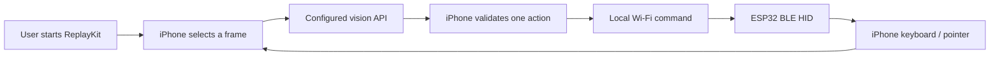

# SightLatch

### See the screen. Plan one step. Act through hardware.

An experimental native iOS agent that connects ReplayKit screen capture, vision-capable AI APIs, and an ESP32 / ESP32-C3 / ESP32-S3 Bluetooth HID bridge. The iPhone observes and plans; the ESP32 performs bounded keyboard and mouse actions.

[简体中文](README.zh-CN.md) · [Getting started](docs/GETTING_STARTED.md) · [Architecture](docs/ARCHITECTURE.md) · [Validation](docs/TESTING.md)

> **Development status:** source available for integration and testing. Linux source-contract checks and shared C++ primitive tests have passed. C3 firmware has cloud build checks; Apple SDK builds, physical flashing, and the same-iPhone end-to-end loop remain unverified. No signed application or production-ready release is provided.

[首次安装与使用（中文）](docs/FIRST_RUN.zh-CN.md)

## Why SightLatch?

A phone agent needs both observation and a way to act. SightLatch explores that loop without a desktop controller: the user starts a system screen broadcast, the phone sends selected frames to a configured vision API, and validated single-step commands travel over the local network to a Bluetooth HID device.

- **Native control surface** — SwiftUI app, setup checks, task history, model profiles, and a Liquid Glass interface targeting iOS 26.
- **Explicit observation** — user-started ReplayKit capture, frame selection, request limits, and visible session state.
- **Provider choice** — adapters for OpenAI Responses, OpenAI-compatible Chat Completions, Anthropic Messages, and Gemini.
- **Physical execution** — ESP32 firmware with explicit App ARM/STOP controls, pairing windows, sequence checks, command deadlines, and input release.
- **Bounded sessions** — stop verification, expiry handling, and an optional iOS 26 continued-processing path. Live Activities display status; they do not grant permanent background execution.

## The loop



There is no livestream publishing step and no remote server that directly controls the ESP32. When a cloud model is configured, selected screenshots and task text leave the phone for that provider. An on-device vision model is not included.

## Start with a controlled test

1. Read [Getting started](docs/GETTING_STARTED.md) and the [known limits](#known-limits).
2. Open `ios/SightLatch.xcodeproj` in Xcode, select your Development Team for all three targets with automatic signing, and run on your iPhone. No copied config file or project generator is needed.
3. Flash a supported C3 variant using the [web installer guide](docs/ESP32_C3_SETUP.zh-CN.md), then configure Wi-Fi and a device token over USB. No external GPIO wiring is required.
4. Verify the App stop control and manual pointer calibration before enabling AI steps.
5. Use a non-sensitive test screen, inspect each action, and keep the USB power connection accessible so you can unplug it if software STOP is unconfirmed.

The Xcode project, shared scheme, targets and products are named **SightLatch**. Existing bundle identifiers, App Group / Keychain identifiers, storage formats and protocol fields retain their historical values for compatibility. Keep any existing local signing overrides when updating.

## Known limits

| Area | Current boundary |
| --- | --- |
| Input | Relative mouse movement and printable ASCII keyboard input; no arbitrary touch injection, multi-touch, or direct Chinese Unicode typing |
| iPhone integration | Same-device BLE HID reception, pointer visibility in ReplayKit, and background behavior need hardware validation |
| Networking | Local HTTP with a bearer token; only use an isolated, trusted LAN. Do not expose it to the internet |
| Model safety | Validation and conservative defaults reduce mistakes but cannot guarantee a model's decisions are safe |
| Subscriptions | Experimental ChatGPT plan sign-in is separate from API-key billing; native login and entitlement availability need device verification. No cookie reuse or silent API fallback |
| Background execution | Subject to iOS scheduling, memory, cancellation, and extension lifecycle limits |

## New integration guides

- [Stateful agent loop](docs/AGENT_LOOP.md)
- [Siri, voice input and Live Activities](docs/SIRI_SHORTCUTS_LIVE_ACTIVITIES.md)
- [Fish Audio voice feedback](docs/FISH_AUDIO.zh-CN.md)
- [Experimental official ChatGPT plan login](docs/CHATGPT_PLAN_LOGIN.zh-CN.md)
- [C3 browser flashing](docs/ESP32_C3_SETUP.zh-CN.md); a live installer URL requires successful Pages deployment

## Project layout

```text
ios/        SwiftUI app, ReplayKit extension, Live Activity, shared models
firmware/   ESP32 BLE HID bridge and configuration template
tests/      Source-contract checks and shared C++ primitive tests
docs/       Architecture, setup, validation, and research references
```

## Validation and development

See [Testing](docs/TESTING.md) for reproducible host checks and the unverified device acceptance steps. Apple CI is manually triggered only; pushing a commit does not start the provided workflow. Check GitHub runner billing before running it.

When reporting a problem, include OS/toolchain/board versions, the first relevant error, and redacted logs. Do not include API keys, device tokens, Wi-Fi passwords, signing materials, or private screen contents.

## License and dependencies

This project is licensed under [MIT](LICENSE). Third-party dependencies retain their respective licenses. ChatGPT plan integration is additionally subject to the [SIWC terms](https://openai.com/policies/sign-in-with-chatgpt-terms/).

## Brand assets

[SVG / PNG / iOS app icon](assets/brand/README.md) · [Visual preview](assets/brand/brand-preview.png)

Additional public builds cover classic ESP32 (USB-UART) and ESP32-S3 (hardware USB Serial/JTAG / USB-UART), retaining the existing C3 images. These are compile-verified, not board/iPhone-verified. S2 and other unlisted chips are rejected. S3 uses DIO80/4MB; see the [compatibility matrix](docs/BOARD_COMPATIBILITY.zh-CN.md).
