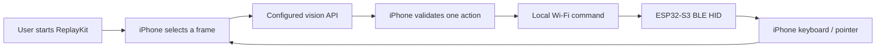

# SightLatch

### See the screen. Plan one step. Act through hardware.

An experimental native iOS agent that connects ReplayKit screen capture, vision-capable AI APIs, and an ESP32-S3 Bluetooth HID bridge. The iPhone observes and plans; the ESP32 performs bounded keyboard and mouse actions.

[简体中文](README.zh-CN.md) · [Getting started](docs/GETTING_STARTED.md) · [Architecture](docs/ARCHITECTURE.md) · [Validation](docs/TESTING.md)

> **Development status:** source available for integration and testing. Linux source-contract checks and shared C++ primitive tests have passed. Native iOS builds, complete firmware builds, and the same-iPhone end-to-end loop have not been validated. No signed application or production-ready release is provided.

## Why SightLatch?

A phone agent needs both observation and a way to act. SightLatch explores that loop without a desktop controller: the user starts a system screen broadcast, the phone sends selected frames to a configured vision API, and validated single-step commands travel over the local network to a Bluetooth HID device.

- **Native control surface** — SwiftUI app, setup checks, task history, model profiles, and a Liquid Glass interface targeting iOS 26.
- **Explicit observation** — user-started ReplayKit capture, frame selection, request limits, and visible session state.
- **Provider choice** — adapters for OpenAI Responses, OpenAI-compatible Chat Completions, Anthropic Messages, and Gemini.
- **Physical execution** — ESP32-S3 firmware with ARM/STOP controls, pairing windows, sequence checks, command deadlines, and input release.
- **Bounded sessions** — stop verification, expiry handling, and an optional iOS 26 continued-processing path. Live Activities display status; they do not grant permanent background execution.

## The loop



There is no livestream publishing step and no remote server that directly controls the ESP32. When a cloud model is configured, selected screenshots and task text leave the phone for that provider. An on-device vision model is not included.

## Start with a controlled test

1. Read [Getting started](docs/GETTING_STARTED.md) and the [known limits](#known-limits).
2. Open `ios/HIDPilot.xcodeproj` in Xcode and configure your signing identifiers using `ios/Config/Local.xcconfig`.
3. Configure and flash the ESP32-S3 following the [firmware guide](firmware/README.md).
4. Verify the physical stop control and manual pointer calibration before enabling AI steps.
5. Use a non-sensitive test screen, inspect each action, and keep the physical stop control available.

The internal Xcode project, target names, bundle identifiers, storage identifiers, and protocol fields retain **HIDPilot** for compatibility. User-facing branding is **SightLatch**; do not rename signing or shared-container identifiers merely to match the product name.

## Known limits

| Area | Current boundary |
| --- | --- |
| Input | Relative mouse movement and printable ASCII keyboard input; no arbitrary touch injection, multi-touch, or direct Chinese Unicode typing |
| iPhone integration | Same-device BLE HID reception, pointer visibility in ReplayKit, and background behavior need hardware validation |
| Networking | Local HTTP with a bearer token; only use an isolated, trusted LAN. Do not expose it to the internet |
| Model safety | Validation and conservative defaults reduce mistakes but cannot guarantee a model's decisions are safe |
| Subscriptions | No built-in ChatGPT subscription OAuth, cookie reuse, or third-party coding-plan credit integration |
| Background execution | Subject to iOS scheduling, memory, cancellation, and extension lifecycle limits |

## Project layout

```text
ios/        SwiftUI app, ReplayKit extension, Live Activity, shared models
firmware/   ESP32-S3 BLE HID bridge and configuration template
tests/      Source-contract checks and shared C++ primitive tests
docs/       Architecture, setup, validation, and research references
```

## Validation and development

See [Testing](docs/TESTING.md) for reproducible host checks and the unverified device acceptance steps. Apple CI is manually triggered only; pushing a commit does not start the provided workflow. Check GitHub runner billing before running it.

When reporting a problem, include OS/toolchain/board versions, the first relevant error, and redacted logs. Do not include API keys, device tokens, Wi-Fi passwords, signing materials, or private screen contents.

## License and dependencies

A project license has not yet been selected. Public source visibility does not itself grant an open-source license. Third-party frameworks and dependencies retain their respective licenses; consult the platform and firmware documentation before redistribution.
