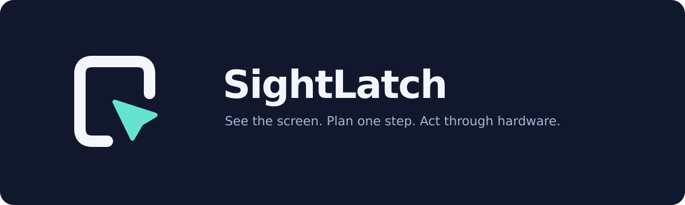

# SightLatch

### 让手机看见屏幕，通过硬件完成下一步操作。

SightLatch 是一个原生 iOS AI 操作实验项目，将 ReplayKit 读屏、视觉模型 API 与 ESP32-S3 蓝牙 HID 连接起来。观察、规划和指令校验在手机侧完成，硬件端负责执行有边界的键鼠动作。

[English](README.md) · [开始使用](docs/GETTING_STARTED.md) · [架构说明](docs/ARCHITECTURE.md) · [验证状态](docs/TESTING.md)

> **当前状态：开发中，提供可检查和集成的源码。** 已有 Linux 源码契约检查及共享 C++ 逻辑测试结果；iOS 原生编译、完整固件编译、同一部 iPhone 上的读屏与 HID 闭环仍需验证。暂无已签名安装包，不宣称生产可用。

[首次安装与使用（中文）](docs/FIRST_RUN.zh-CN.md)

## 核心能力

- **原生操作界面**：面向 iOS 26 的 SwiftUI 与 Liquid Glass，包含首次引导、模型档案、任务历史、配置恢复和诊断导出。
- **主动授权读屏**：由用户启动系统 ReplayKit 广播，筛选画面并限制请求与操作步数。
- **多模型适配**：OpenAI Responses、OpenAI 兼容 Chat Completions、Anthropic Messages、Gemini 图片请求。
- **硬件执行闭环**：通过可信局域网向 ESP32-S3 发送单步指令，再由 BLE HID 操作手机。
- **可见且有界的会话**：物理 ARM/STOP、指令序号与期限、停止结果复核、Live Activity 状态和可选的 iOS 26 有界后台任务。

## 工作方式

用户开始系统广播 → 手机筛选截图 → 所选视觉模型规划 → 手机校验一个动作 → 局域网发送至 ESP32 → 蓝牙键鼠输入 → 再观察结果。

无需把画面发布到直播平台，也不依赖电脑发出控制指令。但如果接入云端 AI，选中的截图与任务文字会发送给对应服务商，不能将其称为“所有数据都留在本机”。当前没有内置端侧视觉模型。

## 快速开始

1. 阅读[开始使用](docs/GETTING_STARTED.md)，准备 iOS 26、Xcode 和 ESP32-S3 开发板。
2. 打开 `ios/HIDPilot.xcodeproj`，按 [iOS 配置文档](ios/README.md)设置签名、App Group 和 Keychain 共享组。
3. 按[固件文档](firmware/README.md)配置与刷写开发板，先验证物理停止和手动校准。
4. 配置你拥有权限的模型 API，在不含私人内容的测试屏幕上逐步验收。

产品正式名称为 **SightLatch**。内部 Xcode 工程、target、bundle ID、共享存储和协议标识仍沿用 HIDPilot，以避免破坏签名、历史配置和设备协议。无需为了改名而重设这些标识。

## 能力边界

| 方面 | 当前范围 |
| --- | --- |
| 输入 | 相对鼠标及可打印 ASCII；不支持任意触点、多指手势或中文 Unicode 直接输入 |
| 真机闭环 | 同机 BLE HID、读屏中的指针可见性和后台生命周期尚未实机验收 |
| 局域网 | HTTP + Bearer，命令与令牌在 LAN 上明文传输；仅限隔离可信网络 |
| AI 风险 | 单步校验与保守模式不能保证模型永不误操作 |
| 订阅接入 | 没有 ChatGPT 订阅登录、Cookie 复用或 Coding Plan 额度复用功能 |
| 后台运行 | 受 iOS 调度和资源限制；灵动岛与实时活动不是永久保活手段 |

## 文档导航

- [开始使用](docs/GETTING_STARTED.md)：准备、配置、校准和首次闭环
- [系统架构](docs/ARCHITECTURE.md)：数据流、停止路径和兼容性
- [测试与验收](docs/TESTING.md)：已运行检查与仍需执行的验收
- [功能逐项核对](docs/FEATURE_MATRIX.zh-CN.md)：能力对应的源码入口
- [2026-10-15 验证记录](CURRENT_VALIDATION_20261015.zh-CN.md)：历史检查证据
- [技术研究](docs/research/repositories.md)：参考项目和实现边界

## 参与开发

反馈时请提供系统、Xcode、板型与依赖版本，首个完整错误以及脱敏日志。不要提交 API key、设备令牌、Wi-Fi 密码、证书或私人截图。Apple 编译 workflow 仅手动触发，运行前请核对 GitHub 账户配额及计费。

## 许可

项目尚未选定许可证。仓库公开不等于自动授予开源许可；系统框架与第三方依赖遵循各自许可证，分发时需另行核对。

## 品牌资源

[SVG / PNG / iOS app icon](assets/brand/README.md) · [Visual preview](assets/brand/brand-preview.png)
